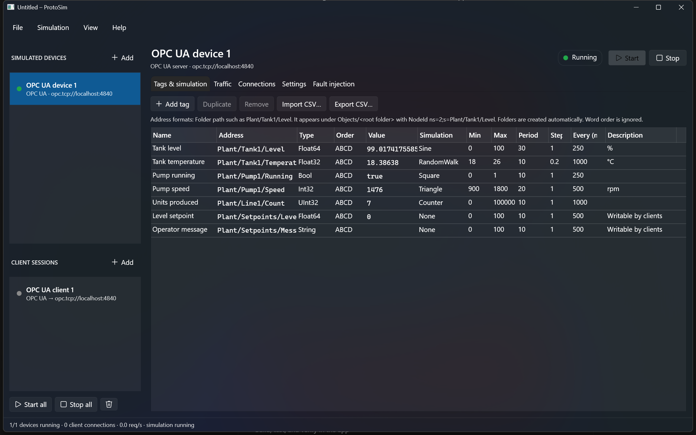
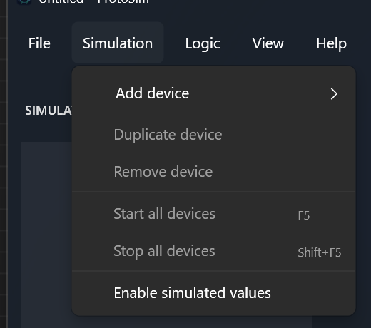
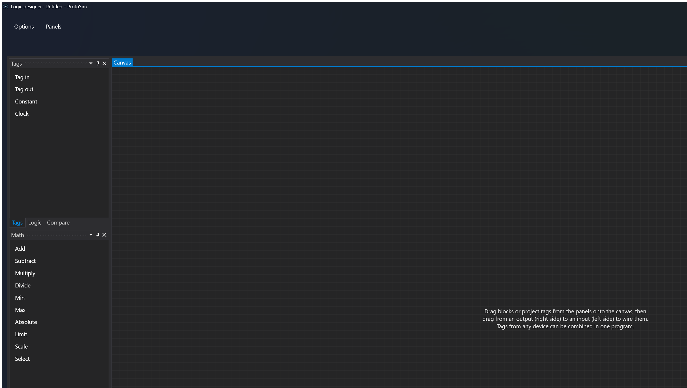
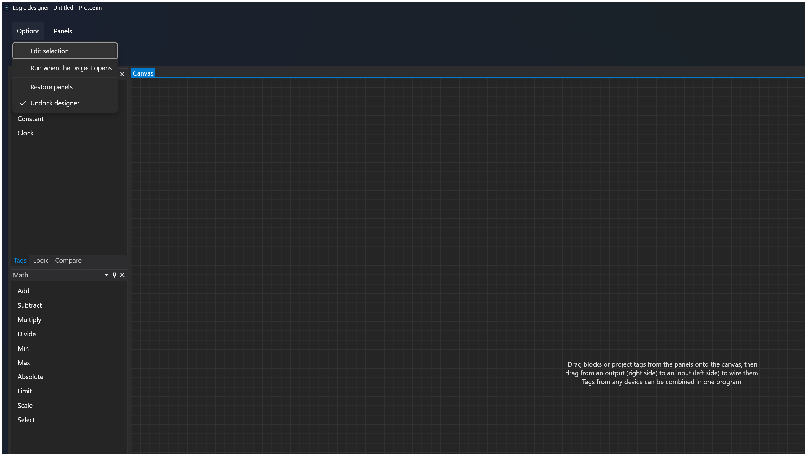
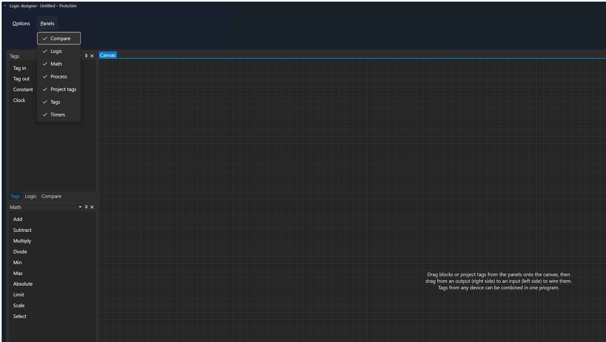
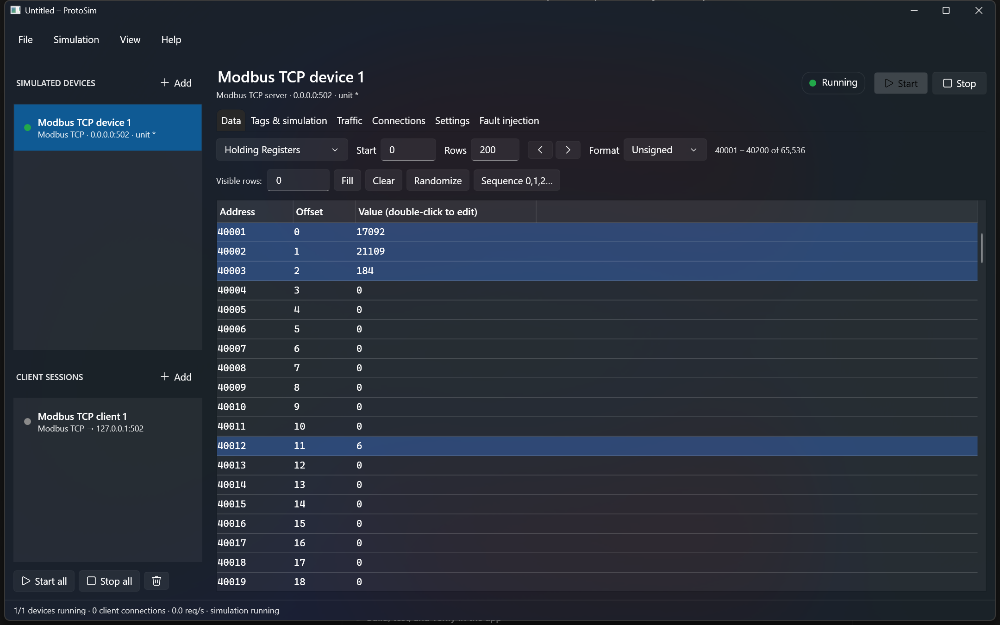

# ProtoSim

ProtoSim is a cross-platform industrial protocol simulator for Windows, macOS and Linux (C#, .NET 10, Avalonia UI with the Fluent theme). It simulates devices that real clients (SCADA, HMI, PLC programs) can talk to, and its own clients pull data in from external servers and devices. Each protocol is a plugin.



Simulation controls are available from the top-level **Simulation** menu:



The logic designer now has a compact top bar, a menu for layout and run options, and individually hideable palette panels. Its screenshots show the updated designer and menus:







## Features

**Simulated devices (servers)**
- Run any number of devices at once, mixing protocols, each on its own port, with a start/stop control and live status.
- **Tags** map typed values (Bool, Int16/32/64, UInt16/32/64, Float32/64, String) onto protocol addresses: Modbus registers, or OPC UA variables in a folder tree.
- **Value simulation** per tag: ramp, sine, triangle, square, random, random walk, counter and toggle, each with its own min/max/period/step/update rate. **None** holds the value still: it changes only when a client, you, a scenario or logic writes it. Tags can be imported and exported as CSV.
- **Writeable** per tag, off by default: only ticked tags accept writes from external clients; the others can be read but not written. A writeable tag's simulation is set to None. The protocol's own "not writable" error comes back (Modbus exception 02, OPC UA `BadNotWritable`, BACnet write-access-denied, SNMP `notWritable`, HTTP 403); MQTT publishes and Sparkplug commands to it are dropped and logged. Local writes (the grid, simulation, scenarios, logic, client mappings) still work.
- **Traffic log** with decoded summaries (and hex bytes for Modbus), filtering, pause, auto-scroll, and export to .log/.csv.
- **Connections and statistics**: connected clients or sessions (with a button to drop each one), requests/s, errors and unanswered requests.
- **Fault injection** (applies while running): response delay and jitter, timeouts, error responses, and random disconnects.
- **Record and replay**: record every tag's value changes to a CSV (`offset_s,tag,value`) and play them back at 0.25–60× speed, optionally looping. Timestamped CSVs (e.g. historian exports) replay too. Replayed tags pause their simulation.
- **Logic designer**: drag-and-drop function block programs that read and write tags on *any* device in the project, so separate simulators behave like one real system (a Modbus level sensor driving an OPC UA pump command, a BACnet setpoint feeding a PID loop...). About 40 blocks: tag in/out, constants, clock, AND/OR/XOR/NOT, SR/RS latches, edge detection, comparisons and hysteresis, math, scale/limit/select, TON/TOF/TP timers, CTU/CTD counters, PID, first-order lag, integrator (tank), rate limiter, noise and dead time. Programs run on a scan cycle with live values on the canvas, feedback loops allowed, edits applied while running, and are saved with the project. Open it from the **Logic** menu; palette and project-tag panels can be closed or hidden individually and restored from **Panels**, with the layout remembered between runs. The **Options** menu controls auto-run, restores the default panel layout, and docks or undocks the designer. Right-click a block to edit its properties or delete it; program and block settings are available from the selection editor. The color-coded run status is right-aligned beside the program selector, with program controls at the upper right.
- **Scenario scripts**: a timed script per device, saved with the project, e.g. `0 ramp Tank level from 20 to 80 over 30s`, `30s set Pump running = false`, `+5s fault error 50 code 4`, `60s device stop`, with `repeat` to loop. Fault settings changed by a scenario are restored when it ends.

**Clients**
- Add a client from **Simulation > Add client** or the **Clients** list on the left to connect to any external server or device, real or simulated. Send a request once or poll it on an interval, with decoded results, success/failure counters and a traffic log.
- **Copy into tags**: map result rows to project tags (`Device/Tag`). After every successful request the values are written into those tags, so simulated servers re-publish them and logic programs can use them. Mapped tags pause their own simulation while polling. A client can start polling when the project opens.

| Client | What it does |
|---|---|
| Modbus TCP | Every function code the server supports: read coils/inputs/registers, single and multiple writes, mask write, read/write multiple, device identification. Registers are decoded with a data type and word order; Quantity counts values of that type. |
| Modbus RTU (serial) / over TCP | The same requests as an RTU master on a COM port, or RTU frames over TCP. Responses are length-checked and CRC-checked; the unit ID must match. |
| OPC UA | Browse (as a tree, with values), Read, Write (converted to each node's type) and Subscribe (poll to see the latest notifications). Security, user name login and auto-accepting the server certificate are optional. |
| MQTT | Subscribe to topic filters (+ and # wildcards) and keep the latest payload per topic, or Publish with QoS and retain. TLS and user name login are optional. |
| Sparkplug B | A host application: watches births, data and deaths for a group (or all groups), resolves aliases, shows every metric with its online state, sends NCMD/DCMD writes and Rebirth requests, and can publish STATE as the primary host. |
| REST API | Any method and path with an optional body. Basic, bearer token or OAuth 2.0 client credentials (renewed automatically). JSON responses become one row per value (path such as data.items[0].value), or only the paths you list. |
| MTConnect | Probe, Current, Sample (continues from the last nextSequence) and Assets against any agent, with an optional XPath filter. One row per data item, keyed by its ID. |
| DNP3 | A TCP master: integrity and event polls, range reads per point type, CROB (latch, pulse, trip/close) and analog output commands, select-before-operate or direct. Polled values are kept, so events update the rows. |
| BACnet/IP | Who-Is discovery, the device's object list with names and present values, ReadProperty of any property, and WriteProperty with a priority ('null' relinquishes). |
| SNMP | A v1/v2c manager: Get, Walk (subtree, with a limit) and Set with an explicit SNMP type. |
| Scripted device | A line-oriented terminal for ASCII instruments over TCP, UDP or serial: sends each command and waits for its reply (newline, custom terminator or silence), with an optional regex to pull the value out. Listen shows unsolicited messages such as a streaming scale. |

**Simulation network**
- The **network wizard** (**Network › Network wizard…**, Ctrl+Shift+W) connects simulators the way controllers in a real plant talk to each other: devices in one ProtoSim, or in ProtoSim instances on other computers (one per PC or Raspberry Pi). Pick a source device, tick its tags, and pick the device that receives them; the wizard can create the receiving tags with free addresses.
- A **network link** polls the source with its own protocol (real traffic, visible in both traffic logs) and copies each value into a project tag. *Read + write* points also send changes made here back to the source, when the source tag is Writeable. Links show every point's value and status, start with the project if you like, and are saved with it.
- Sources: Modbus TCP/RTU, OPC UA, MQTT, Sparkplug B, REST API (this computer only), SNMP, BACnet/IP, DNP3 and MTConnect (read-only), or any server or real device of those protocols with addresses you type.
- **LAN discovery**: each ProtoSim answers searches on UDP 47900 and serves its devices and tags (with their connection settings) on a TCP port of its own. Turn it off with **Network › Share devices on the network**. Computers on another subnet can be asked by name or IP.

**Projects**
- Save and open `.psim` files (JSON). A project holds devices, settings, faults, tags and their values, Modbus memory, client sessions with their tag mappings, network links, and logic programs. A device can be set to start automatically when the project opens, and a client to start polling.
- Command line: `ProtoSim.exe project.psim` opens a project. `ProtoSim.exe --demo modbus-tcp` or `--demo opc-ua` starts a running demo device with sample tags.
- Light, dark or system theme (View menu).

## Modbus TCP



| Function | Code |
|---|---|
| Read Coils / Discrete Inputs | 01 / 02 |
| Read Holding / Input Registers | 03 / 04 |
| Write Single Coil / Register | 05 / 06 |
| Diagnostics: Return Query Data | 08/00 |
| Write Multiple Coils / Registers | 15 / 16 |
| Mask Write Register | 22 |
| Read/Write Multiple Registers | 23 |
| Read Device Identification (basic, regular, individual) | 43/14 |

- Raw memory tables for coils, discrete inputs, input registers and holding registers. Values can be shown as unsigned, signed, hex, binary or ASCII, edited in place, and filled, cleared, randomized or numbered in bulk. Values that just changed are highlighted.
- Requests are checked against the spec's quantity limits and return the correct exception codes. Other settings: which unit IDs to answer (`*`, `1,2,10-20`), gateway exceptions 0x0A/0x0B for other unit IDs, unit 0 as broadcast, read-only mode, the size of each memory area, and the device identification strings.
- Tag addresses: `HR:0`, `IR:0`, `CO:0`, `DI:0` (0-based offsets), `40001` / `400001` (Modicon, 1-based), and `HR:10.3` (one bit of a register). Multi-register values can use any word order (ABCD, CDAB, BADC, DCBA).

### Modbus RTU

**Modbus RTU (serial)** runs a slave on a COM port (default 19200 8E1, unit 1, frames end after 3.5 character times), and **Modbus RTU over TCP** carries the same RTU frames (unit + PDU + CRC-16, no MBAP header) over TCP, like a serial device server. Both share the Modbus TCP request handler, memory tables and tag addresses. Bad-CRC frames are ignored, other unit IDs get no reply by default, and unit 0 is a silent broadcast. Use a virtual COM port pair such as com0com to test the serial slave without hardware.

## OPC UA

Built on the official OPC Foundation .NET Standard stack (2.0.2).

- **Server:** each tag becomes a variable node in a folder tree under `Objects`. Every `.` or `/` in the address is a folder level: `BOB.MARY.SUE.PV` browses as Objects > BOB > MARY > SUE > PV, with the NodeId as typed (`ns=2;s=BOB.MARY.SUE.PV`). An optional root folder setting puts everything under one folder. Nodes appear and disappear live as tags are added or removed, and simulated values are pushed to subscriptions.
- **Security:** None, Basic256Sha256 Sign, and Sign & Encrypt. Login can be anonymous, with a user name and password, or both. A self-signed application certificate is created on first start in `%LocalAppData%\ProtoSim\pki`, and untrusted client certificates can be accepted automatically.
- **Settings:** host name, port (4840), endpoint path, namespace URI, root folder, read-only mode, maximum sessions and minimum sampling interval.
- **Fault injection:** delay, simulated timeouts (`BadTimeout`), error responses (codes are mapped to OPC UA status codes such as `BadInternalError` and `BadNodeIdUnknown`), and closing sessions.

## Build and run

Requires the .NET 10 SDK on Windows, macOS or Linux. NuGet restores the packages on the first build.

```bash
dotnet build ProtoSim.slnx
```

```bash
dotnet test ProtoSim.slnx
```

```bash
dotnet run --project src/ProtoSim.App
```

Build output goes to `artifacts/`. If the repository sits in a very deep folder, it goes to `%TEMP%\ProtoSim\artifacts` instead, to stay under the Windows 260-character path limit.

### Standalone builds

Each build is a single self-contained executable, so the target computer doesn't need .NET:

```bash
dotnet publish src/ProtoSim.App -c Release -r win-x64 -o publish/win-x64
dotnet publish src/ProtoSim.App -c Release -r linux-x64 -o publish/linux-x64
dotnet publish src/ProtoSim.App -c Release -r linux-arm64 -o publish/linux-arm64
dotnet publish src/ProtoSim.App -c Release -r osx-arm64 -o publish/osx-arm64
dotnet publish src/ProtoSim.App -c Release -r osx-x64 -o publish/osx-x64
```

Any OS can build for any other. `linux-arm64` also covers a 64-bit Raspberry Pi OS with a desktop.

### Platform notes

- **Linux:** needs a desktop (X11, or Wayland through XWayland) and the usual libraries: on Debian or Ubuntu, `sudo apt install libx11-6 libice6 libsm6 libfontconfig1`.
- **macOS:** the published executable isn't signed. Run `xattr -d com.apple.quarantine ProtoSim` once, then `chmod +x ProtoSim`. Shortcuts use Command instead of Ctrl.
- **Ports below 1024** (Modbus 502, SNMP 161) need extra rights on Linux and on some macOS setups. Use a higher port in the device settings (such as 5020), or on Linux grant the executable `cap_net_bind_service` with `setcap`.
- **Serial ports** are named `COM3` on Windows, `/dev/ttyUSB0` on Linux (your user must be in the `dialout` group) and `/dev/cu.usbserial-XXXX` on macOS.
- **Settings and data** are stored in the per-user app data folder: `%LocalAppData%\ProtoSim`, `~/.local/share/ProtoSim` or `~/Library/Application Support/ProtoSim`.

## REST API

A local-only JSON API simulator (listens on `127.0.0.1`/`::1` only) with a configurable base URL, default `http://localhost:5080/api/v1`.

- **Bearer tokens**: OAuth 2.0 client credentials endpoint (`/oauth/token`) issuing HS256 JWTs. Each client has its own client ID, secret and optional scopes, managed on the **API clients** tab. Authentication can be turned off.
- **Simulated GET endpoints**: each tag's address is a path (e.g. `sensors/temperature`), simulated like any other protocol; PUT/PATCH/POST to the path writes the value.
- **JSON database** for everything else: `GET/POST /users`, `GET/PUT/PATCH/DELETE /users/{id}`, with json-server style filtering, sorting and paging. It is created once per device in `%LocalAppData%\ProtoSim\RestDatabases`, persists every change, and can be edited, recreated, exported and imported on the **Database** tab.

## BACnet/IP

A BACnet/IP device (UDP 47808) built on the MIT-licensed [BACnet](https://github.com/ela-compil/BACnet) stack.

- Tag addresses are objects: `AI:1`, `AO:1`, `AV:3/Zone Setpoint`, `BI`/`BO`/`BV` (Bool), `MSI`/`MSO`/`MSV` (1..N), `CSV:1` (String).
- Who-Is/I-Am, Who-Has/I-Have, ReadProperty(Multiple) including ALL, WriteProperty(Multiple) with a 16-level priority array and relinquish default, Out_Of_Service on inputs.
- SubscribeCOV / SubscribeCOVProperty with COV increment, DeviceCommunicationControl, ReinitializeDevice and TimeSynchronization.

## SNMP agent

An SNMPv1/v2c agent (UDP 161) for simulating UPSs, PDUs, switches and other monitored equipment. Messages are encoded with the MIT-licensed [#SNMP](https://github.com/lextudio/sharpsnmplib) library.

- Tag addresses are scalar OIDs, e.g. `1.3.6.1.4.1.99999.1.1.0`, with an optional `:counter32`, `:gauge32`, `:timeticks`, `:counter64`, `:ipaddress`, `:truthvalue` or `:string` syntax.
- Built-in system group (sysDescr, sysObjectID, sysUpTime, sysContact, sysName, sysLocation, sysServices).
- Get, GetNext, GetBulk and atomic Set with v1 and v2c error semantics; read and write community strings.
- v2c traps: coldStart on start and, optionally, a trap carrying the values of each Set.

## MTConnect

An MTConnect agent (HTTP, port 5000) for a simulated machine tool.

- Tag addresses are data items in a component tree: `Axes/Linear[X]/Xact:POSITION.ACTUAL`, `Controller/Path/execution:EXECUTION`, `Controller/system:SYSTEM`. The category (sample, event or condition) and default units come from the type, and can be overridden with `:SAMPLE`, `:EVENT` or `:CONDITION`.
- `probe`, `current` (with `at`), `sample` (with `from` and `count`) and `assets`, with or without the device name in the URL, and `path` filters evaluated as real XPath over the probe document.
- Every value change becomes a numbered observation in a circular buffer (unchanged values are skipped unless configured). The agent reports `firstSequence`, `lastSequence` and `nextSequence`, and returns MTConnect errors such as `OUT_OF_RANGE`, `INVALID_XPATH` and `NO_DEVICE`.
- XML by default, or JSON (the reference agent's JSON version 2 layout) with `Accept: application/json` or `?format=json`; the device's default format is a setting.
- Streaming (`interval`) isn't supported; clients poll `current` or `sample`.

## Scripted device

A text request/reply device over TCP, UDP or a serial port for instruments, scales, barcode readers and legacy ASCII protocols. Behaviour comes from rules in the device settings, one per line:

```
*IDN?                      => ProtoSim,Virtual Instrument,SN0001,1.0
MEAS:TEMP?                 => {Temperature:F2}
/SOUR:VOLT (?<v>[-0-9.]+)/ => {Setpoint=$v}OK
OUTP?                      => {Output:1/0}
```

- Plain patterns match the whole request; `/regex/` patterns capture groups for `{$1}` / `{$name}`.
- `{Tag}` / `{Tag:format}` insert tag values, `{Tag=$1}` writes them, `{now:HH:mm:ss}` inserts the time; `\r \n \t \xHH` escapes.
- Framing by CR, LF, any newline, a custom terminator or a silent gap; a reply terminator, optional echo, unknown-command and error replies.
- A greeting on connect and a periodic message (e.g. a scale streaming weight) for unsolicited output.

## Sparkplug B

A Sparkplug B edge node (`spBv1.0/{group}/.../{edge node}`) that can run its own MQTT broker or connect to an external one.

- Tag addresses are metric names: `Inputs/Temperature` for an edge node metric, `Pump1:Speed` for a metric of device `Pump1`.
- NBIRTH/DBIRTH on connect, NDEATH with `bdSeq` as the MQTT will, report-by-exception NDATA/DDATA with `seq`, optional aliases.
- NCMD/DCMD write metrics; `Node Control/Rebirth` and tag changes trigger rebirths; optional primary host STATE awareness.
- Payloads are encoded with a small built-in protobuf codec (no generated code).

## Architecture

```
src/
  ProtoSim.Core                 Protocol-agnostic: plugin contracts, data model, register codec,
                                simulation engine, traffic log, statistics, fault settings, project format
  ProtoSim.Protocols.ModbusTcp  Modbus TCP, RTU (serial) and RTU-over-TCP plugins: data model, request handler, servers
  ProtoSim.Protocols.OpcUa      OPC UA plugin: variable model, node manager, server
  ProtoSim.Protocols.Rest       REST API plugin: loopback HTTP/1.1 server, OAuth 2.0 client credentials,
                                tag endpoints, JSON document database
  ProtoSim.Protocols.Bacnet     BACnet/IP plugin: object model, priority arrays, COV, on the BACnet NuGet stack
  ProtoSim.Protocols.MTConnect  MTConnect agent plugin: HTTP server, component tree, observation buffer, XPath filters
  ProtoSim.Protocols.Script     Scripted device plugin: rule engine and templates over TCP, UDP or serial
  ProtoSim.Protocols.Snmp       SNMP agent plugin: MIB view of system group and tag OIDs, v1/v2c requests, traps
  ProtoSim.Protocols.SparkplugB Sparkplug B plugin: protobuf payload codec, edge node over MQTTnet, embedded broker
  ProtoSim.App                  Avalonia UI (MVVM); knows protocols only through IProtocolPlugin
tests/
  ModbusTcp.Tests               Codec, addressing, request handler, RTU framing/CRC, loopback tests, the Modbus TCP client and Writeable tags
  OpcUa.Tests                   Variable model and loopback tests with the OPC UA client (browse, read, write, subscribe, security, login, Writeable)
  Rest.Tests                    Token, auth, tag, CRUD/query, persistence/export and loopback HTTP tests
  Bacnet.Tests                  Address rules and loopback tests with a BACnet client (discovery, reads, commands, COV, DCC, faults)
  MTConnect.Tests               Address rules and HTTP tests for probe, current, sample, XPath, buffer wrap, errors and faults
  Core.Tests                    Recording, replay, scenarios, and the logic engine (blocks, timers, feedback, PID, cross-device tags)
  Script.Tests                  Rule parsing, templates, writes, framing, and TCP/UDP request/reply, greeting and periodic output
  Snmp.Tests                    OID/syntax rules, Get/GetNext/GetBulk/Set semantics, communities, faults, UDP and traps
  SparkplugB.Tests              Payload codec, addressing, and births/data/commands/STATE against the embedded broker
```

The UI never references protocol types. Everything it shows comes from these Core abstractions:

- `IProtocolPlugin`: the protocol's entry point. It creates settings, data models and servers.
- `IDeviceDataModel`: the device memory. Register protocols expose `IDataArea` tables, which the UI shows as the Data tab. Node-based protocols such as OPC UA expose no tables and work through tags only.
- `ITagBinding`: a typed value at a protocol-specific address, which the simulation engine drives. It is disposed when a tag is removed, so node-based protocols can delete the node.
- `IProtocolServer`: the running simulated device.
- `IProtocolClient` (optional): a client session. A plugin opts in by returning client settings and request types; `ClientResultRow.Typed` carries the value copied into mapped tags.
- `ITagBinding.RemoteWritable`: the tag's Writeable box. Protocols check it (or `RemoteWriteGuard` for values shared by several tags) before applying a client write.
- Settings and request objects are plain classes. A reflection-based property grid edits them (using `[Display]`, `[Range]` and `[Browsable(false)]` attributes), and they are saved as JSON. **A new protocol needs no UI code.**

## Adding a protocol

1. Create a class library that references `ProtoSim.Core`.
2. Implement `IProtocolPlugin`, plus `IDeviceDataModel` and `IProtocolServer`. `RegisterCodec`, `TrafficLog`, `ServerStatistics` and `FaultSettings` can be reused.
3. Either drop the built DLL into a `Plugins` folder next to `ProtoSim.exe` (it is discovered at startup), or register the plugin in `App.xaml.cs` as is done for the built-in plugins.

Natural next protocols: MTConnect streaming and assets, and IEC 61850.
