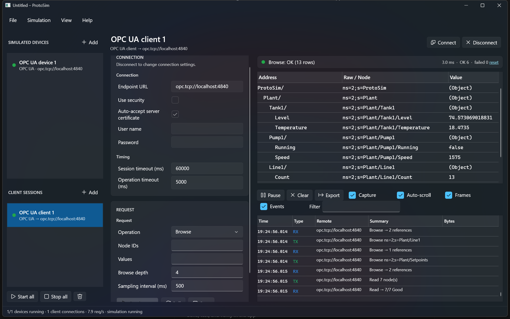
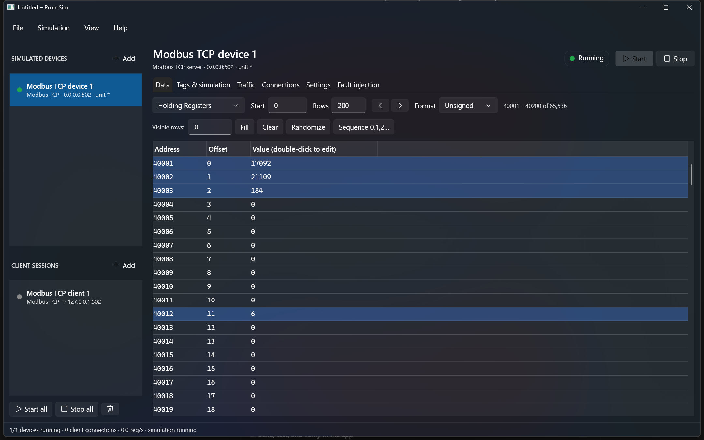
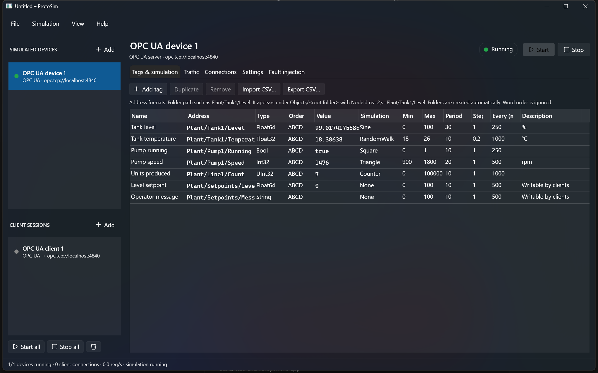

# ProtoSim

ProtoSim is an industrial protocol simulator for Windows (C#, .NET 10, WPF with the built-in Fluent theme). It simulates devices that real clients (SCADA, HMI, PLC programs) can talk to, and it can also test devices with built-in client sessions. Each protocol is a plugin. **Modbus TCP** and **OPC UA** are included.



## Features

**Simulated devices (servers)**
- Run any number of devices at once, mixing protocols, each on its own port, with a start/stop control and live status.
- **Tags** map typed values (Bool, Int16/32/64, UInt16/32/64, Float32/64, String) onto protocol addresses: Modbus registers, or OPC UA variables in a folder tree.
- **Value simulation** per tag: ramp, sine, triangle, square, random, random walk, counter and toggle, each with its own min/max/period/step/update rate. Tags can be imported and exported as CSV.
- **Traffic log** with decoded summaries (and hex bytes for Modbus), filtering, pause, auto-scroll, and export to .log/.csv.
- **Connections and statistics**: connected clients or sessions (with a button to drop each one), requests/s, errors and unanswered requests.
- **Fault injection** (applies while running): response delay and jitter, timeouts, error responses, and random disconnects.

**Client sessions (masters)**
- Connect to any server, simulated or real. Send a request once or poll it on an interval, with typed decoding of the results, success/failure counters, and the same traffic log.

**Projects**
- Save and open `.psim` files (JSON). A project holds devices, settings, faults, tags and their values, Modbus memory, and client sessions. A device can be set to start automatically when the project opens.
- Command line: `ProtoSim.exe project.psim` opens a project. `ProtoSim.exe --demo modbus-tcp` or `--demo opc-ua` starts a demo device with a client pointed at it.
- Light, dark or system theme (View menu).

## Modbus TCP



| Function | Code |
|---|---|
| Read Coils / Discrete Inputs | 01 / 02 |
| Read Holding / Input Registers | 03 / 04 |
| Write Single Coil / Register | 05 / 06 |
| Diagnostics: Return Query Data | 08/00 |
| Write Multiple Coils / Registers | 15 / 16 |
| Mask Write Register | 22 |
| Read/Write Multiple Registers | 23 |
| Read Device Identification (basic, regular, individual) | 43/14 |

- Raw memory tables for coils, discrete inputs, input registers and holding registers. Values can be shown as unsigned, signed, hex, binary or ASCII, edited in place, and filled, cleared, randomized or numbered in bulk. Values that just changed are highlighted.
- Requests are checked against the spec's quantity limits and return the correct exception codes. Other settings: which unit IDs to answer (`*`, `1,2,10-20`), gateway exceptions 0x0A/0x0B for other unit IDs, unit 0 as broadcast, read-only mode, the size of each memory area, and the device identification strings.
- Tag addresses: `HR:0`, `IR:0`, `CO:0`, `DI:0` (0-based offsets), `40001` / `400001` (Modicon, 1-based), and `HR:10.3` (one bit of a register). Multi-register values can use any word order (ABCD, CDAB, BADC, DCBA).

## OPC UA



Built on the official OPC Foundation .NET Standard stack (1.5.378).

- **Server:** each tag becomes a variable node under `Objects/<root folder>`. A tag address like `Plant/Tank1/Level` creates the folders and the NodeId `ns=2;s=Plant/Tank1/Level`. Nodes appear and disappear live as tags are added or removed, and simulated values are pushed to subscriptions.
- **Security:** None, Basic256Sha256 Sign, and Sign & Encrypt. Login can be anonymous, with a user name and password, or both. A self-signed application certificate is created on first start in `%LocalAppData%\ProtoSim\pki`, and untrusted client certificates can be accepted automatically.
- **Settings:** host name, port (4840), endpoint path, namespace URI, root folder, read-only mode, maximum sessions and minimum sampling interval.
- **Client:** Browse (as a tree, with live values), Read, Write (values are converted to each node's data type), and Subscribe (monitored items; poll the request to see the latest notifications). It can use security, a user name and password, and auto-accept the server certificate.
- **Fault injection:** delay, simulated timeouts (`BadTimeout`), error responses (codes are mapped to OPC UA status codes such as `BadInternalError` and `BadNodeIdUnknown`), and closing sessions.

## Build and run

Requires the .NET 10 SDK on Windows. NuGet restores the OPC UA packages on the first build.

```bash
dotnet build ProtoSim.slnx
```

```bash
dotnet test ProtoSim.slnx
```

```bash
dotnet run --project src/ProtoSim.App -- --demo opc-ua
```

Build output goes to `artifacts/`. If the repository sits in a very deep folder, it goes to `%TEMP%\ProtoSim\artifacts` instead, to stay under the Windows 260-character path limit.

## Architecture

```
src/
  ProtoSim.Core                 Protocol-agnostic: plugin contracts, data model, register codec,
                                simulation engine, traffic log, statistics, fault settings, project format
  ProtoSim.Protocols.ModbusTcp  Modbus TCP plugin: data model, request handler, TCP server, TCP client
  ProtoSim.Protocols.OpcUa      OPC UA plugin: variable model, node manager, server, client
  ProtoSim.App                  WPF UI (MVVM); knows protocols only through IProtocolPlugin
tests/
  ModbusTcp.Tests               Codec, addressing, request handler and loopback tests
  OpcUa.Tests                   Variable model and loopback tests (browse, read, write, subscribe, security, login)
```

The UI never references protocol types. Everything it shows comes from these Core abstractions:

- `IProtocolPlugin`: the protocol's entry point. It creates settings, data models, servers and clients.
- `IDeviceDataModel`: the device memory. Register protocols expose `IDataArea` tables, which the UI shows as the Data tab. Node-based protocols such as OPC UA expose no tables and work through tags only.
- `ITagBinding`: a typed value at a protocol-specific address, which the simulation engine drives. It is disposed when a tag is removed, so node-based protocols can delete the node.
- `IProtocolServer` / `IProtocolClient`: the runtime objects.
- Settings and request objects are plain classes. A reflection-based property grid edits them (using `[Display]`, `[Range]` and `[Browsable(false)]` attributes), and they are saved as JSON. **A new protocol needs no WPF code.**

## Adding a protocol

1. Create a class library that references `ProtoSim.Core`.
2. Implement `IProtocolPlugin`, plus `IDeviceDataModel`, `IProtocolServer` and/or `IProtocolClient`. `RegisterCodec`, `TrafficLog`, `ServerStatistics` and `FaultSettings` can be reused.
3. Either drop the built DLL into a `Plugins` folder next to `ProtoSim.exe` (it is discovered at startup), or register the plugin in `App.xaml.cs` as is done for the built-in plugins.

Natural next protocols: Modbus RTU-over-TCP / serial (`ModbusRequestHandler` is transport-independent and can be reused), DNP3, IEC 60870-5-104, Siemens S7 and EtherNet/IP.
